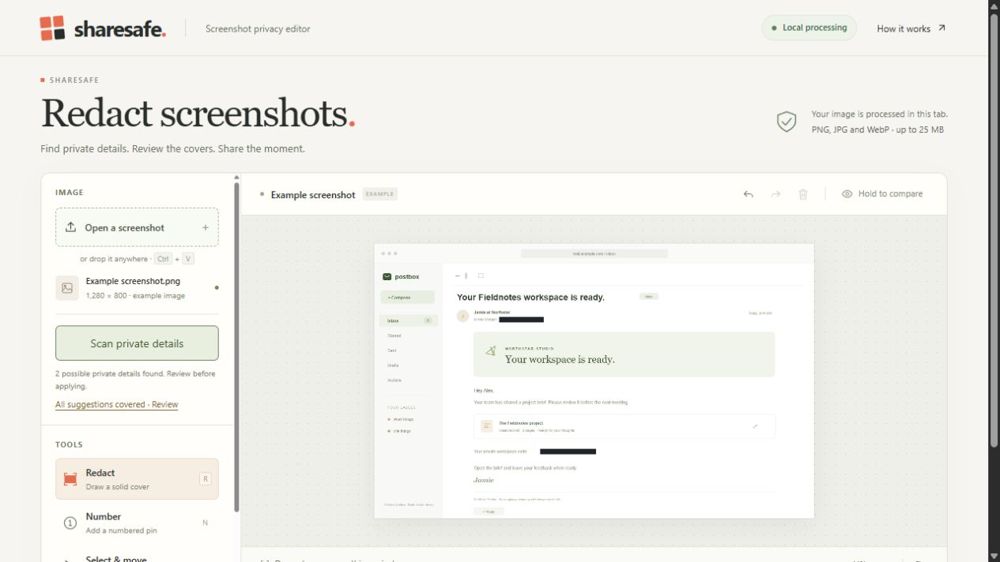

ShareSafe

A browser-local screenshot editor with automatic private-detail suggestions. Open an image, review the scan, apply solid covers, and export a flattened PNG.



Quickest way to try it

Download **ShareSafe.html** and open it in a current desktop browser with WebAssembly SIMD support (current Chrome, Edge, Firefox or Safari). In the extracted source, **dist/index.html** is the same complete application. The roughly 8 MB HTML contains the editor, example, English OCR model and worker. No account, server, API key or network download is needed to scan.

New images scan automatically. To test the bundled fictional example, click **Scan private details**. It starts with no pre-applied covers, so you can see the scan's suggestions and resulting changes.

Using the editor

- **Scan:** local English text recognition suggests emails, formatted/labeled phone numbers, IPv4 addresses, Luhn-valid payment cards, common API-token prefixes, and labeled passwords/private workspace codes.
- **Review:** numbered dashed boxes show the suggestions. Inspect the image, select individual suggestions, then choose **Cover selected**. Suggestions do not become covers until applied. Applying a batch is one undo step. Cancel stops the worker immediately.
- **Redact (R):** draw additional opaque covers over anything the scan missed. Choose ink, paper or coral.
- **Number (N):** add numbered pins for context.
- **Select (V):** move edits or resize covers from a corner. Arrow keys nudge by one pixel; Shift moves ten.
- **Undo/redo:** Ctrl/Command+Z and Ctrl/Command+Shift+Z. Ctrl/Command+Y also redoes. History retains up to 60 changes.
- **Compare:** hold the eye button to view the original. Zoom or Fit as needed.
- **Export:** check the full image, confirm the review box, and download a PNG at the original resolution. Uncovered scan suggestions produce a warning.

Open, paste or drop one PNG, JPG or WebP. Maximum 25 MB, 24 megapixels and 12,000 pixels per side. The scan surface is capped at six megapixels; export keeps the original dimensions.

Privacy and limitations

The neural OCR model runs in a dedicated browser worker. Structured pattern checks convert recognized text into suggested covers. This is OCR-assisted detection, not a cloud language model or a model we trained.

Image bytes and recognized text stay in browser memory. No image upload, AI API, analytics, local storage, IndexedDB cache or automatic saved copy is used. CSP blocks application network connections with `connect-src 'none'`; a bundled Blob worker and WebAssembly compilation are permitted. Closing or reloading loses the editing session. Hosting the HTML still requires an ordinary request to the host.

**Review the whole screenshot.** English OCR can misread or miss text, especially small, rotated, low-contrast or unusual text. Names, postal addresses, faces, QR codes and arbitrary sensitive messages are not automatically identified. A clean scan is not proof that an image is safe. Inspect the cover edges and add manual covers as needed.

The original remains in memory for editing and comparison. Export renders the source and applied opaque covers into a separate canvas. It omits dashed suggestions, editor controls, editable layers, original attachments and undo history. Cover edges round outward to whole pixels. Re-encoding does not carry source EXIF/text metadata into the new PNG. Information outside covers remains visible.

Development and checks

The full modular source is in **ShareSafe-source.zip**. The distributed HTML runs without installation. To rebuild after editing `src/editor.html` or JavaScript/CSS in `dist/`, use Node.js 20 or later:

```sh
npm ci --ignore-scripts
npm run build
npm run check
npm test
npm run dev
```

The optional server opens at `http://127.0.0.1:4173/`. Windows users can use `Start ShareSafe.cmd`. All three HTML entry files are identical and self-contained; code and styles are protected by CSP hashes.

Thirteen tests cover editing geometry, history, opaque export rendering, structured-detail matching, OCR word-to-image coordinates, split OCR blocks, offline assets and CSP hashes. Browser QA found both private details in the bundled example and all six expected details in a separate fictional fixture. Selective application, undo/redo, cancel, automatic import scanning and phone-width review were exercised. This small fixture check is not a general accuracy benchmark.

The browser exports were independently decoded with `tools/verify-ocr-export.mjs`: 1280 × 800, 4,510 changed pixels in the two intended regions, all opaque ink; no dashed preview marks or text/EXIF metadata. `tools/verify-example-export.mjs` is retained as a historical check for the earlier manual example. More evidence and limits are in `docs/VALIDATION.md`.

Implementation and credits

Vanilla HTML/CSS/JavaScript, Canvas 2D and a pinned Tesseract.js 7.0.0 worker/core with the existing English LSTM model. The offline builder embeds dependencies; no paid service is needed. Third-party licenses are in **THIRD_PARTY_NOTICES.txt** and embedded in each HTML file.

ShareSafe's application code and fictional example were created for this project with significant assistance from OpenAI Codex. The OCR engine, model and their dependencies are existing open-source components, not original model training.

The repository includes a captioned demo made from actual app captures. It has not been uploaded to YouTube; that upload awaits the owner's review and approval.